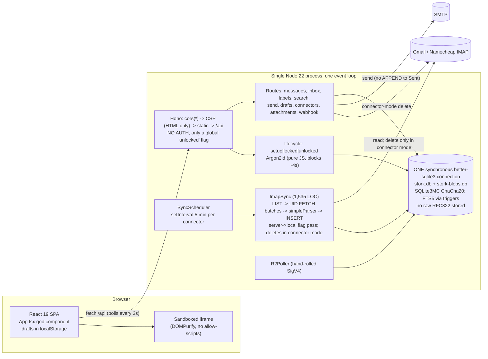

# Stork fork-readiness and security audit

| | |
|---|---|
| **Subject** | upstream [`paperkite-hq/stork`](https://github.com/paperkite-hq/stork) at `1b1c0f2` (v0.7.0 + docs, last commit 2026-04-20) |
| **Audited on** | 2026-10-15 |
| **Branch** | `audit` on `ytjohn/stork` |
| **Application code changed** | None. Everything is under `audit/`, which upstream CI does not pick up. |
| **Mail used** | No real accounts were contacted. All IMAP testing ran against a disposable Dovecot 2.3.21 (`audit/harness/dovecot.sh`). |
| **Target use** | Gmail + Namecheap stay authoritative. Stork would hold a fast local indexed copy, serve the web UI and later an Android PWA, give AI agents an API, and run as a private container or on Kubernetes. |

---

## 1. Executive assessment

**Verdict: FORK, but do not keep Stork's IMAP sync engine.** Do not adopt as-is. Rewriting the sync engine yourself is not worth it.

**Can you safely use Stork today as your primary webmail, with Gmail and Namecheap authoritative?**

**No**, for three independent reasons, all reproduced with executable tests:

1. **The local copy is not trustworthy, even in Mirror mode.**
   - Read/star changes made in the UI are silently reverted at the next sync.
   - A move in the UI causes the message to be deleted locally at the next sync and never downloaded again.
   - A folder rename or UIDVALIDITY change on the server wipes that folder locally, along with your labels.
   - Any message that fails to parse once is skipped forever, with no lasting error.
   - A message nested 21 or more MIME levels deep, which anyone can send you, is silently dropped.
   - On Gmail, every message is stored and returned in search once per label.
   - Details: `sync/FINDINGS.md`, `sync-edge/FINDINGS.md`.
2. **Changes never reach the authoritative servers.** Nothing is written back to IMAP: no flags, moves, `\Answered`, Sent copies or drafts. The only server writes are deletions, and those happen only in Connector mode. Connector mode deletes mail it never stored, and can delete unrelated mail through stale (folder, UID) pairs.
3. **There is no authentication after unlock, and CORS is `*`.**
   - Any website you visit can read and send your mail.
   - The first visitor to a fresh instance can claim it.
   - A crafted email can run script on the app's origin. This was proven in Chromium.
   - Details: `security/FINDINGS.md`.

**What is good, and worth keeping:**
- **Server safety in Mirror mode:** it never writes to the server, verified on the wire.
- **Encryption at rest is real:** the main DB, blobs DB and WAL are all encrypted. Note the cipher is ChaCha20-Poly1305, not the AES-256 the docs claim.
- **The HTML email sandbox is solid.**
- **The codebase is small and readable:** about 20.8k production LOC, with a green test suite (1,849 unit tests plus 44 e2e).
- **Easy to self-host:** no telemetry or CDNs, and plain-text FTS5 search is fast.
- Overall maintainability: **3/5**.

**Recommended path:**

| Option | What it is | Effort | Verdict |
|---|---|---|---|
| **A** | Fork Stork and fix its IMAP sync | 6–10+ weeks plus a long soak, highest data-loss risk | **No.** You would be rebuilding what mbsync already does well. |
| **B** | Fork Stork as a UI/API/search layer **over your existing mbsync Maildir**. mbsync stays the only thing talking to Gmail and Namecheap. | ~3–5 weeks | **Recommended if you want Stork's UI and an HTTP agent API.** Prototyped successfully (`alternatives/`). |
| **C** | mbsync → Maildir → local Dovecot (FTS) → Roundcube/SnappyMail; notmuch for agents. No Stork. | 1–3 days | **Smallest viable alternative.** Lowest maintenance. |
| **D** | Stalwart + Bulwark (JMAP webmail, PWA), fed by an mbsync IMAP↔IMAP channel | 2–5 days setup | **Pilot read-only.** Best long-term shape for agents (JMAP), but Stalwart is still 0.x with weekly releases. A lost mbsync state file duplicated the whole mailbox in both directions (reproduced). |

If you take B, Stork's encryption-at-rest selling point no longer applies, because the Maildir beside it is plaintext. Use volume encryption instead.

## 2. Architecture (actual implementation)

The full diagrams (7 Mermaid diagrams, including the lock state machine and the inbound and send data flows) are in [`arch/architecture.md`](arch/architecture.md).



Key structural facts: [`arch/MAINTAINABILITY.md`](arch/MAINTAINABILITY.md) §1–2.
- HTTP, sync, parsing, KDF and FTS all share one thread and one synchronous DB connection.
- The natural seam is a sync worker thread with its own DB connection.
- The "connection pool" never reuses a connection.

## 3. Risk register

**Columns:**
- **Sev:** C = critical, H = high, M = medium, L = low.
- **Likelihood:** whether it happens in normal daily use with Gmail and Namecheap.
- **Mode:** M = Mirror, Cn = Connector. "Mirror" is the only mode under consideration.

| ID | Risk | Sev | Impact | Likelihood | Mode | Code | Evidence |
|---|---|---|---|---|---|---|---|
| R1 | No auth after unlock; CORS `*`; no lock/logout | C | Any web page reads and sends your mail | High once exposed or open in a browser | all | `src/api/server.ts:25,70-75` | `security/c1-auth-cors.test.ts` |
| R2 | Connector mode deletes the requested batch, not the stored set. Clean-server and UI delete use stale (folder, UID) pairs | C | Permanent loss on the provider | High if Connector mode is ever enabled | Cn | `imap-sync.ts:582-661,1232-1270`; `sync-scheduler.ts:211-248`; `messages.ts:173-211` | `sync/connector-mode.test.ts` |
| R3 | UI move rewrites `folder_id` only, so the next sync deletes the row; UID squatting | C | Local loss, wrong flags, new mail not stored | High (normal use) | M | `messages.ts:155-171,313-326`; `imap-sync.ts:994-1008` | `sync/local-ops.test.ts` |
| R4 | Stored XSS via `attachments/by-cid` | H | Attacker email, plus one click, reads the mailbox | Medium | all | `attachments.ts:46-70` | `security/h1-m1-browser.test.ts` |
| R5 | Pre-setup takeover | H | Attacker owns the instance | Low (deploy window only) | all | `encryption.ts:38-53` | `security/c2-setup-takeover.test.ts` |
| R6 | STARTTLS accepts any certificate (SMTP; IMAP by code reading) | H | Credentials captured by a MITM | Low–Medium | all | `smtp.ts:31`; `imap.ts:31-36` | `security/h2-smtp-tls.test.ts` |
| R7 | No flag write-back; local flag edits reverted | H | Read/star state diverges from Gmail and is silently undone | Certain | M | `messages.ts:134-153,277-298`; `imap-sync.ts:962-978` | `sync/flags.test.ts` |
| R8 | Folder rename/delete or UIDVALIDITY change wipes the local folder | H (M) / C (Cn) | Labels lost; Connector archive lost | Medium | M, Cn | `imap-sync.ts:417-443,520-526` | `sync/folders.test.ts`, `sync/uidvalidity.test.ts` |
| R9 | A failed message is skipped forever; MIME depth ≥21 silently dropped | H | Silent permanent gaps in the archive | Medium (anyone can send one) | M | `imap-sync.ts:778,871,884-913` | `sync/fetch-failures.test.ts`, `sync-edge/hostile-mime.test.ts` |
| R10 | Gmail: no X-GM-EXT-1; one row per label; All Mail/Spam/Trash all synced | H (Gmail) | N× storage, duplicate search hits, wrong counts | Certain on Gmail | M | `imap-sync.ts:380-421,1031` | `sync-edge/gmail-layout.test.ts` |
| R11 | Raw RFC822 not stored | M | No faithful export; S/MIME/PGP not re-verifiable; unparseable mail unrecoverable | Certain | all | `imap-sync.ts:1447` | `sync-edge/hostile-mime.test.ts` |
| R12 | Search: raw FTS5 syntax returns 500 for addresses, `AT&T`, hyphens; UI shows 0 results | H (UX) | Gmail-style search unusable for common queries | Certain | all | `search/search.ts:91-94` | `perf/results/search-100k.json` (`crash`) |
| R13 | `label:` + free text binds parameters in the wrong order | M | Wrong results or error | High when combined | all | `search/search.ts:93` vs `:149-153` | `alternatives/MAILDIR-OPTION.md` §7 |
| R14 | Migrations not crash-safe: version bumped once at the end, no transactions | H | DB bricked by a crash during upgrade (reproduced from 6 start versions) | Low per upgrade | all | `storage/db.ts:112-118` | `arch/evidence/` |
| R15 | `STORK_FAST_KDF` persists; password change doesn't rewrite KDF params | M | Lockout with the correct password | Low | all | `crypto/keys.ts:21-23,146-154,235-241,352-356` | `security/m4-kdf-lockout.test.ts` |
| R16 | Sync stalls: no socket timeout; drip-feed hangs indefinitely | H | Sync silently stops | Medium | all | `connectors/imap.ts` (no `socketTimeout`) | `sync-edge/network-faults.test.ts` |
| R17 | Large attachment buffered whole; 100 MB peaks at ~1.1 GB RSS | H | OOM, then likely crash loop on the same batch | Medium | all | `imap-sync.ts:781-881` | `sync-edge/large-attachments.test.ts` |
| R18 | Unlock KDF blocks the event loop ~4–5 s; rate limit global and post-hoc | M | Trivial DoS | Medium if exposed | all | `encryption.ts:16-25`; `keys.ts:63` | `security/m2-unlock-dos.test.ts` |
| R19 | SSRF via test-smtp and R2 `account_id` | M | Internal port probing, signed requests | Low (needs R1) | all | `send.ts:212`; `r2-poller.ts:261` | `security/m3-ssrf.test.ts` |
| R20 | Backoff never resets; partial failure reported as success; `[THROTTLED]` dropped | M | 30-min polling until restart; no backoff on Gmail throttling | Medium | all | `sync-scheduler.ts:398-426`; `imap-sync.ts:1528` | `sync-edge/network-faults.test.ts` |
| R21 | Newest message re-downloaded every cycle (`last_uid+1:*`) | M | UI delete of the newest message undone; wasted bandwidth | Certain | M | `imap-sync.ts:550` | `sync/local-ops.test.ts` |
| R22 | Dependencies: 7 production advisories (6 high); nodemailer needs 8→10, imapflow 1→2 | M | Known CVEs (hono CORS, nodemailer CRLF/ReDoS, linkify-it DoS) | — | all | `package.json` | `arch/DEPENDENCIES.md` |
| R23 | Container runs as root; no `USER`, no dropped capabilities | M | Larger blast radius | — | all | `Dockerfile` | `security/FINDINGS.md` K1 |
| R24 | Bus factor: imapflow, mailparser and nodemailer share one maintainer; better-sqlite3-multiple-ciphers is a single-maintainer fork that owns the on-disk cipher format | M | Stuck upgrades; the cipher format makes migration costly | Low–Medium | all | — | `arch/DEPENDENCIES.md` §5 |
| R25 | Docs mislead on security (cipher, `timingSafeEqual`, key zeroing), API (3 phantom routes, 19 missing) and config (sync interval) | M | Wrong operational decisions | — | — | — | `arch/MAINTAINABILITY.md` §4 |
| R26 | Backend never type-checked in CI; 49 `tsc` errors (~22 are tests calling renamed APIs) | M | Tests that don't test what they say; regressions | — | — | CI config | `arch/evidence/` |
| R27 | Every sync cycle freezes the whole server (`refreshLabelCounts` is a synchronous full scan) | H | UI unresponsive ~25–30 s per connector every 5 min at ~200k; 70 s at 500k | Certain at scale | all | `imap-sync.ts:1066-1121` | `perf/results/concurrency-*.json` |
| R28 | Upgrade from schema ≤ v29 fails at v30 (`no such column: date`) | H | Existing DBs can't upgrade; combined with R14, the DB is left unopenable | Certain for old DBs | all | `storage/db.ts:301`; `schema.ts:1231` | `perf/results/lifecycle-100k-kdf-open-migrate.json` |
| R29 | SIGTERM shutdown takes 13–70 s, past the 10 s force-exit | M | SIGKILL under docker/k8s (crash-safe in 9/9 runs, but slow restarts) | Certain at scale | all | `src/index.ts` | `perf/results/lifecycle-*.json` |

## 4. Synchronization matrix

Observed against real Dovecot. Full table with test references: [`sync/FINDINGS.md`](sync/FINDINGS.md#sync-matrix).

| Operation | Server → local | Local → server | Observed |
|---|---|---|---|
| Initial sync / resume after abort or SIGKILL | ✔ | — | No duplicates, no loss. ~101 msg/s. |
| Incremental new mail | ✔ (quirks) | — | Newest message re-fetched every cycle (R21); a failed message is skipped forever (R9) |
| `\Seen` / `\Flagged` / `\Draft` | ✔ add and remove | ✘ unsupported | Local change reverted at the next sync |
| `\Answered` | ✔ | ✘ | Replying never sets it |
| Local delete | — | Mirror: local only (newest message comes back). Connector: **destructive** | Stale (folder, UID) pairs can hit the wrong message |
| Server expunge | **Destructive** (local hard delete, no tombstone) | — | Mirror is not an archive |
| Local move | — | ✘, and **destructive** locally | Row deleted next sync; HTTP 500 on UID collision |
| Server move | Delete + new | — | Labels and local flags lost; relabel is broken for nested folders |
| Copy / Gmail labels | Duplicate rows | — | One row, one FTS entry and one search hit per folder |
| Folder create | ✔ | ✘ | — |
| Folder rename / delete | **Destructive** (cascade) | ✘ | Connector archive lost |
| UIDVALIDITY reset | **Destructive** (folder wipe) | — | Connector archive lost |
| Local labels | — | Local only | Lost on move, rename or UIDVALIDITY change |
| Send → Sent | — | ✘ (no APPEND) | Local-only Sent folder |
| Drafts | — | ✘ | UI uses `localStorage`; the server drafts API is unused |
| Namecheap layout (`.` separator, no SPECIAL-USE) | ✔ | — | Works; sidebar doesn't nest dotted names |
| Network drop / stall / throttle | Partial | — | Resume OK; stalls hang (R16); no throttle backoff (R20) |

**Genuinely bidirectional:** nothing.
**One-way, server → local:** new mail, flags, expunges, folder creation.
**Unsupported locally → server:** flags, moves, folder operations, Sent, drafts.
**Destructive:** Connector-mode sync, Clean server, Connector UI delete, UI move, folder rename/delete, UIDVALIDITY reset.

## 5. Security findings

Full report with exact reproduction steps, observed evidence and patch sketches: [`security/FINDINGS.md`](security/FINDINGS.md). The suite has 18 PoC tests.

| ID | Finding | Severity | Status | Fix (short) |
|---|---|---|---|---|
| C1 | No auth after unlock; CORS `*`; no lock | Critical | EXPLOITABLE | Session cookie or token at unlock on all `/api`; remove `cors()`; `/api/lock` + idle timeout |
| C2 | Pre-setup takeover | High | EXPLOITABLE | Bootstrap secret from env or file, or loopback-only setup |
| H1 | by-cid stored XSS on the app origin | High | EXPLOITABLE (Chromium) | `Content-Disposition: attachment` + `nosniff` + sandbox CSP; images-only inline |
| H2 | STARTTLS accepts any certificate | High | EXPLOITABLE (needs MITM) | `rejectUnauthorized: true`, `requireTLS: true` |
| M2 | Unlock KDF blocks the event loop; weak rate limit | Med/High | EXPLOITABLE (DoS) | KDF in a worker; gate before the KDF; single-flight |
| M3 | SSRF (test-smtp, R2 `account_id`) | Med/High | EXPLOITABLE | Validate `account_id`; deny internal ranges; auth |
| M4 | FAST_KDF persistence → lockout | Med/High | EXPLOITABLE | Rewrite params on every re-wrap; test-only flag |
| W1 | Webhook secret returned by list API; non-constant-time compare | Medium | EXPLOITABLE | Don't return secrets; use `crypto.timingSafeEqual` |
| X1 | text/plain CSRF; framable; missing headers | Medium | EXPLOITABLE / THEORETICAL | `frame-ancestors 'none'`, `nosniff`, JSON-only mutations |
| K1 | Container runs as root | Medium | THEORETICAL | `USER node`; k8s `runAsNonRoot`, read-only root FS, drop ALL |
| M1 | Remote images fetched before stripping | — | **REFUTED** | (still prefer `DOMParser`) |

- **Done well:** encryption at rest (main DB, blobs and WAL encrypted; keys file 0600); sandboxed iframe rendering; attachment download headers; parameterised SQL throughout.
- **Multi-account isolation:** Stork is single-user, with no user or token model. An agent API needs one designed from scratch.
- **Backup/restore:**
  - There is no export feature.
  - Back up by checkpointing, then copying the data dir.
  - Restore needs `stork.keys` plus the password or mnemonic.

## 6. Performance results

Full methodology, environment, raw tables and ranked bottlenecks with code references are in [`perf/README.md`](perf/README.md). Raw JSON is in `perf/results/`.

**Hardware and conditions:**

| | |
|---|---|
| Machine | 4 vCPU Xeon @ 2.80 GHz (Firecracker VM), 15.7 GB RAM, no swap, virtio disk |
| Software | Node 22.22.0, SQLite 3.53.0 (SQLite3MC) |
| Load | Other audit agents ran concurrently (1-min load average 1.0–4.2, recorded per result). Treat differences under ~20% as noise. |
| Repetition | 5+ repeats per timed result (median/p95) |
| Corpus | Seeded synthetic: Zipf vocabulary of ≥20k words, realistic sizes, HTML parts and attachments, threads, ~500 senders, 5 years of dates, plus "needle" terms with known frequencies |

**How each dataset was built:**
- **10k and 50k:** the real path, Dovecot → `ImapSync.syncAll` → encrypted DB.
- **100k and 500k:** built with the same `fetchUidBatch` INSERT and the real label/count maintenance, but without IMAP or mailparser, batched 1,000 per transaction. Syncing 500k through IMAP would take ~1.4 h per run plus ~20 GB of Maildir, so it was not run.

**Reproduce:**
```bash
npx tsx audit/perf/run-all.ts --size 10k   # or 50k | 100k | 500k | all (~4–5 h, ~25 GB under /tmp)
npx tsx audit/perf/report.ts all           # print the tables from results/*.json
```

**Results:**

| Measurement | 10k / 50k | 100k | 500k | ≈200k (interpolated) |
|---|---|---|---|---|
| Initial sync via IMAP | 101 / 83 msg/s, 1 core, ~400 MB peak RSS | — | — | 45–60 min, UI stalls throughout |
| **Server freeze per sync cycle with no new mail** (`refreshLabelCounts`, `imap-sync.ts:1066`) | — | **12.6 s** | **66–73 s** | **~25–30 s per connector, every 5 min** |
| Request latency during that resync (8 req/s of UI traffic) | — | median 5.9 s, max 13 s | median 34.5 s, max 71 s | — |
| FTS: rare term / phrase / AND | < 10 ms | 1.6 / 6.4 / 7.6 ms | < 25 ms | < 25 ms |
| FTS: term in 30% of messages | — | 47 ms | 330 ms | ~120 ms |
| FTS: `the` / prefix `pl*` | — | 0.95 / 1.4 s | 3.2 / 6.9 s | 1.5–3 s |
| Filter-only `from:` / `subject:` / `has:` / `label:` | — | 1.1–1.4 s | 6.6–8.3 s | 2–3 s |
| `is:unread` | — | 4.7 s | 23 s | ~9 s |
| Inbox / label page 1, message, 60-message thread | ~2 ms / 15–20 ms | same | same | < 25 ms |
| Last page of a big label (OFFSET) | — | 68 ms (55k label) | 4.9 s (275k label) | 0.1–2 s |
| Flag update (FTS trigger rewrites the whole row) | ~4 ms and 222 KB written each | same | same | 1,000 marks ≈ 4.5 s |
| Unlock (Argon2id, pure JS, blocks the server) | 4.1–5.3 s | same | same | same |
| SIGTERM shutdown | — | 13–15 s | ~70 s | Exceeds the 10 s force-exit, so k8s/docker will SIGKILL |
| SIGKILL / SIGTERM mid-sync (9 runs) | — | Integrity + FTS OK, no duplicates, resumes | — | — |
| RSS: idle / unlocked / peak | — | — | 116 / 176 / 725–760 MB | — |
| DB size | — | 1.65 GB main DB; FTS ≈ 29–30% | — | — |
| HTTP 500 on `user@example.com`, `don't`, `e-mail`, `re:`, `AT&T`, `c++` | yes | yes | yes | yes |

**Root causes, all cheap to fix:**
- **Filter-only searches:** the `JOIN folders` at `search.ts:207` forces a near-full scan. Without it, `from:` at 500k drops from 8,070 ms to **5.9 ms**.
- **`flags` reads:** the column is stored after the large body columns, so reading it scans nearly the whole table. This drives `refreshLabelCounts` and `is:unread`.
- **The FTS update trigger** fires on every column. Restricting it to the indexed columns gives 1,700 updates/s and 43 KB per update. Without that, 150k flag updates grew the FTS index by 55%, and nothing ever runs `optimize`.
- **Per-message autocommit during sync:** wrapping each 100-message batch in one transaction roughly halves the INSERT+FTS cost (2.9 → 1.4 ms per message).
- **Everything runs on one event loop** with a synchronous DB.

**Functional bugs found while benchmarking:**
- **Upgrades from v29 or older fail at v30:** `no such column: date` at `db.ts:301`. The JS backfill hook runs before the SQL migration that adds the column (`schema.ts:1231`).
- **A simulated v24 upgrade at 100k** ran 104 s, failed, and left the DB unopenable on the next start (duplicate column).
- **Thread view from the root message** returns only its direct replies.
- **The mmap setting** is capped at 2 GiB, contrary to the comment in `db.ts`.

**Search is the same speed on Maildir:** `alternatives/` benchmarked Stork's FTS5 against notmuch on the same 10k messages. Hit counts were identical; FTS5 took 4–38 ms and notmuch ~30 ms, mostly process spawn.

## 7. PWA and agent API feasibility

Full analysis: [`pwa-agent/FEASIBILITY.md`](pwa-agent/FEASIBILITY.md). Mobile screenshots at 390×844 are in `pwa-agent/screenshots/`.

| Capability | Class | Effort | Blocker |
|---|---|---|---|
| Installable PWA (manifest, service worker) | Small | S (1–2 d) | **Server returns `index.html` for `/sw.js` and the manifest** (`server.ts:53-54,119`); HTTPS; auth |
| Responsive inbox, thread and compose | Small | S (2 d) | Already usable at phone width; fix `100vh`, hover-only actions, toolbar |
| Offline shell | Small | S | PWA |
| Offline reading | **Architectural** | L (6–10 d) | No change feed (`updated_at`/modseq); plaintext-on-device decision |
| Offline drafts and outbox | Small→Medium | M | Idempotent send; UI ignores the server drafts API |
| Web Push | Contained subsystem | M | PWA, auth, IDLE for latency; `new Notification()` throws on Android |
| IMAP IDLE | Medium | M | Scheduler change (moot under option B: mbsync, or watching the Maildir) |
| Agent search and retrieval | S (escape FTS) + M (v1 API, OpenAPI) | S+M | Raw `.eml` needs raw-source storage (architectural; free under B) |
| Scoped agent tokens and actions | **Architectural** | M–L | No user or token model exists |
| Audit log | Small | S | Tokens |
| `Idempotency-Key` | Small | S | A retried `/api/send` sends twice today |

The root blocker is authentication (C1). Every PWA and agent item depends on it.

## 8. Fork roadmap (option B: Stork over mbsync Maildir)

**P0: before any real mail touches it**

| Item | Description | Effort |
|---|---|---|
| 1 | Authentication: session at unlock, `/api/lock`, idle timeout. Remove `cors()`. Bootstrap secret for setup. Security headers. | ~1 wk |
| 2 | Fix attachment `by-cid` headers (H1); SMTP `rejectUnauthorized` + `requireTLS` (H2). | 0.5 d |
| 3 | Disable the IMAP sync engine and Connector mode entirely: Clean server, connector-mode delete. Remove the UI paths, not just hide them. | 1 d |
| 4 | `npm update` within range. Upgrade hono (fixes the CORS advisory) and mailparser. Plan nodemailer 10. Add `typescript` and a backend `tsc --noEmit` to CI; fix the 49 errors. | 2–3 d |
| 5 | Escape FTS5 input (quote each term); fix the `label:` parameter order. Add tests for malformed queries. | 1 d |
| 6 | Crash-safe migrations: each migration plus its version bump in one transaction. Fix the v30 hook ordering (R28). | 1 d |
| 6b | Remove the per-cycle server freeze: make `refreshLabelCounts` incremental, or index `flags` / add an unread column; drop the `JOIN folders` in filter-only search. | 1–2 d |

**P1: makes it a usable daily driver**

| Item | Description | Effort |
|---|---|---|
| 7 | Maildir inbound connector, following the `alternatives/prototype/` design: side table keyed by Maildir basename and content hash; per-`cur/`/`new/` watches plus periodic scan; read bodies lazily from files (raw source is free). | 1–2 wk |
| 8 | Write-back by renaming Maildir flags (`S`, `F`, `R`, `T`) and moving files (strip `,U=`). mbsync propagates. On Gmail, restrict to flags, archive, remove-label and delete-all-copies. | 1 wk |
| 9 | Collapse Gmail duplicates by content hash; exclude `[Gmail]/Spam` and `Trash` from the index by config. | 2–3 d |
| 10 | Indexed operators: `from:`/`to:`/`subject:` as FTS column filters, `is:unread` via a flag column + index, label join via index. Date-sorted keyset pagination. Restrict the FTS update trigger to text columns. | 3–5 d |
| 11 | Sync/ingest in a worker thread with its own DB connection; KDF off the main thread. | 3–5 d |
| 12 | Container: non-root, read-only root FS, a single PVC; Kubernetes manifests. mbsync as a sidecar or CronJob on a shared volume. Back up mbsync state files with the Maildir. | 2 d |

**P2: features**

| Item | Description | Effort |
|---|---|---|
| 13 | PWA: static routes for `sw.js`/manifest/icons, `vite-plugin-pwa`, app-shell cache only, mobile polish. | 1 wk |
| 14 | Web Push, triggered by new files in the Maildir. | 3–4 d |
| 15 | Agent API v1: normalised JSON, OpenAPI, raw `.eml` endpoint, scoped tokens (read / label / send), audit log, `Idempotency-Key`. Note that notmuch keeps working for local agents meanwhile. | 2–3 wk |
| 16 | SMTP send with Sent copy via a Maildir drop (mbsync uploads it); server-backed drafts. | 3–5 d |
| 17 | Docs: correct the cipher, security claims, API reference and config knobs. | 1–2 d |

**Total to a trustworthy daily driver (P0+P1): roughly 5–7 weeks** for one developer. If the UI isn't the point, option C takes days.

## 9. Dependency inventory

Full table with per-version licence history, maintainers and advisories: [`arch/DEPENDENCIES.md`](arch/DEPENDENCIES.md).

- **Licences:**
  - Everything is compatible with Stork's AGPL-3.0-only.
  - imapflow was MIT from 1.0.65 (2021) onward; earlier versions were UNLICENSED, then AGPL. Stork's range only resolves to MIT.
  - nodemailer is MIT-0.
  - A private personal deployment carries no AGPL obligations. They start once others use the instance over a network.
- **Maintenance risk:**
  - imapflow, mailparser and nodemailer have one shared maintainer. They are active, but the bus factor is 1.
  - better-sqlite3-multiple-ciphers is a single-maintainer fork and owns the on-disk cipher format. Keep an export path.
  - @noble/hashes Argon2 is pure JS and slow. Native `crypto.argon2` arrives in Node 24.7+.
- **Upgrade debt:**
  - The lockfile has been frozen since April 2026.
  - nodemailer 8→10, imapflow 1→2, Tailwind 3→4, Vite 6→8.
  - Stork reaches into imapflow's private `client.socket`, which needs testing on imapflow 2.

## 10. Reproduction guide

**Prerequisites:**
- Node 22, Python 3, Dovecot 2.3 (`apt-get install dovecot-imapd`).
- Optional: Chromium for the browser PoCs; `isync` and `notmuch` for `alternatives/`.
- Tested on Ubuntu 24.04, 4 vCPU, 15 GiB RAM.

```bash
git clone -b audit https://github.com/ytjohn/stork && cd stork
npm ci && (cd frontend && npm ci)

# Baseline: upstream's own suites
STORK_FAST_KDF=1 npx vitest run          # 717 passed, 5 skipped (Docker e2e)
(cd frontend && npx vitest run)          # 1132 passed
npx tsc --noEmit -p .                    # 49 errors (never checked in CI)

# Disposable IMAP server (each suite starts its own on a fixed port; this is for manual poking)
audit/harness/dovecot.sh start /tmp/stork-audit-imap 14143   # users alice/alicepass, bob/bobpass

# Phase 2: sync correctness (real Dovecot; ~3.5 min each)
npx vitest run --config audit/vitest.config.ts audit/sync/       # 61 tests (keep the trailing slash)
npx vitest run --config audit/vitest.config.ts audit/sync-edge   # 48 tests; D8 is timing-sensitive under heavy CPU load

# Phase 3: security PoCs (~1.5 min)
(cd frontend && npx vite build)
PLAYWRIGHT_BROWSERS_PATH=/opt/pw-browsers \
  npx vitest run --config audit/vitest.config.ts audit/security  # 18 tests

# Phase 4: performance — see audit/perf/README.md for per-benchmark commands and dataset sizes

# Alternatives: Maildir prototype and mbsync / Stalwart smoke tests
# see audit/alternatives/MAILDIR-OPTION.md §7 for exact commands
```

Every audit test asserts **current** behaviour, so a passing test means the finding still reproduces. When you fix something in a fork, the matching test should start failing. Invert its assertion so it becomes a regression test.

**Port map (all on 127.0.0.1):**

| Port | Used by |
|---|---|
| 14201 | `sync/` |
| 14202 | `sync-edge/` |
| 14203 | `perf/` |
| 14204 | `alternatives/` |

Base directories must stay under `/tmp`, because the dovecot user has to be able to traverse them.

## 11. What could not be tested

| Item | Reason / substitute |
|---|---|
| `tests/e2e-container.test.ts` (Docker image e2e) | No Docker daemon in the audit environment |
| Real Gmail behaviour (X-GM-EXT-1, `[THROTTLED]`, delete semantics across All Mail) | No live accounts by design. Simulated with a Gmail-shaped Dovecot layout and a fault proxy. **Test option B's Gmail delete semantics on a throwaway Gmail account before relying on them.** |
| hoodiecrow-imap (Gmail-extension emulator) cross-check | Only recent releases are under two weeks old (supply-chain caution) |
| IMAP STARTTLS MITM | Argued from code; the identical SMTP bug was proven |
| Kill between the message INSERT and its attachment INSERTs | better-sqlite3 is synchronous; shown with an injected exception |
| A real server sending partial FETCH data and then NO | Dovecot drops the session instead; reproduced via proxy |
| OOM crash loop on a large attachment | Inferred from measured RSS and the `last_uid` write ordering |
| Stalwart search, Bulwark UI, Stalwart user provisioning | Stalwart docs site blocked by the network proxy; only the binary plus an mbsync IMAP↔IMAP smoke test ran |
| Clickjacking payload | Shown only as "framable" |
| 100k / 500k ingestion through IMAP | ~1.4 h per run plus ~20 GB of Maildir. Those DBs were built through the same INSERT path without IMAP or mailparser (documented in `perf/README.md`) |
| Cold OS page cache | Couldn't drop caches in the container; "cold" means a fresh DB connection only |
| Any CI run on GitHub | Not triggered; everything ran locally |

## Directory map

| Path | Contents |
|---|---|
| `harness/` | Disposable Dovecot launcher |
| `vitest.config.ts` | Audit-only test config |
| `arch/` | Phase 1: architecture, maintainability, dependency inventory, evidence |
| `sync/` | Phase 2: core sync semantics; matrix in `FINDINGS.md` |
| `sync-edge/` | Phase 2: Gmail layout, hostile MIME, large attachments, network faults, Namecheap |
| `security/` | Phase 3: PoCs and `FINDINGS.md` |
| `perf/` | Phase 4: generator, loaders, benchmarks, `results/` |
| `pwa-agent/` | Phase 5: feasibility and screenshots |
| `alternatives/` | Maildir option prototype; mbsync / Stalwart comparisons |
