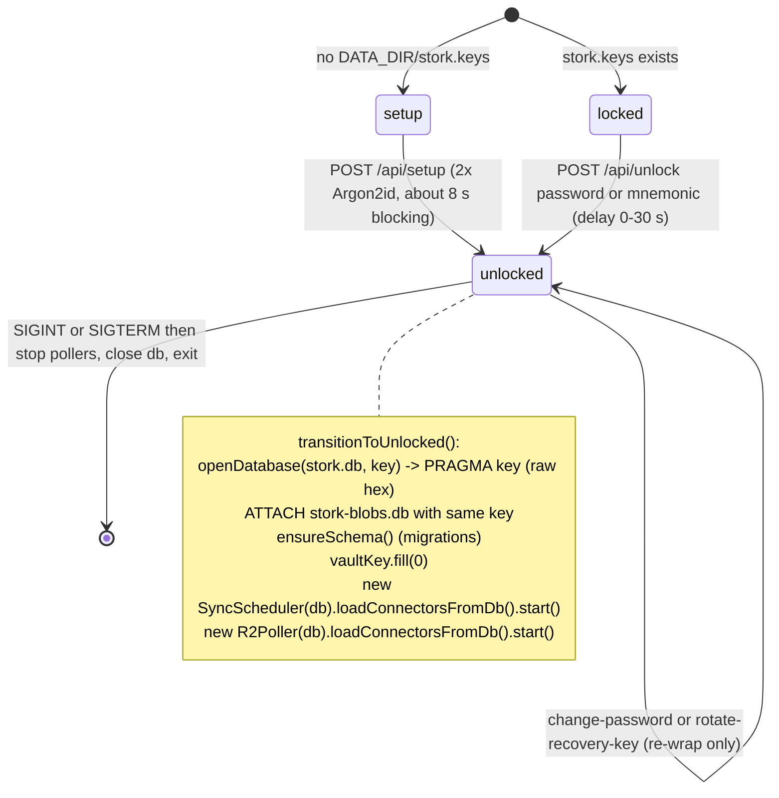
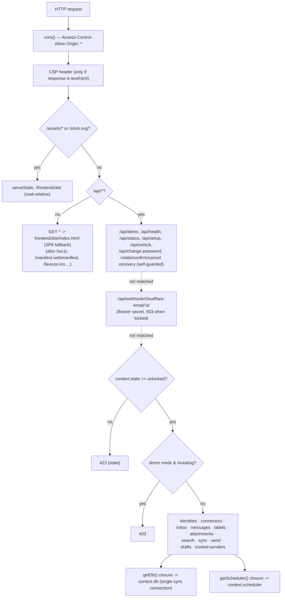
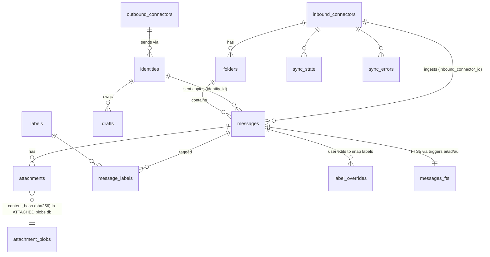
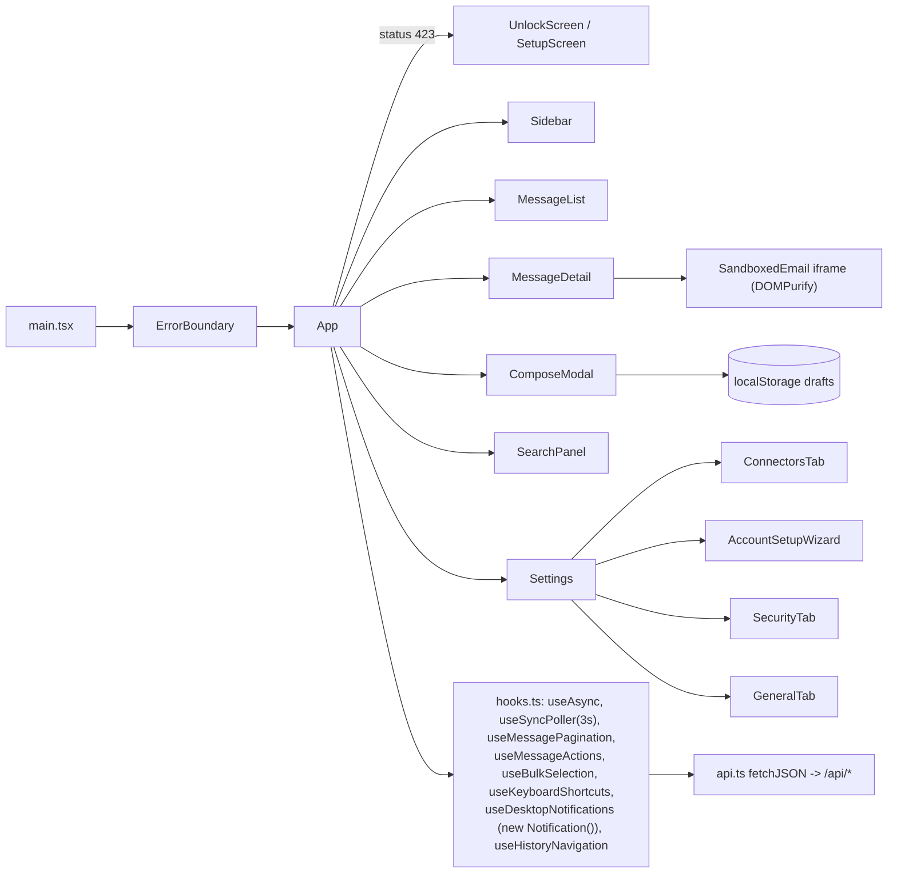
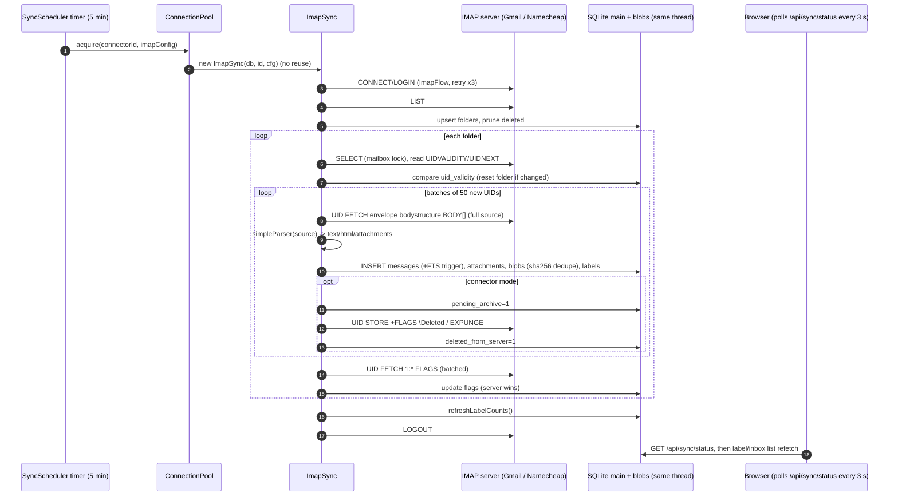
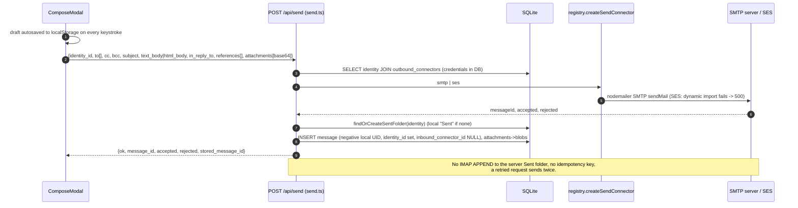

# Stork: the architecture as implemented

Audit of branch `audit` at upstream HEAD `1b1c0f2` (2026-04-20). Everything below comes from reading the code, not the docs. Where the docs disagree, see the "Misleading documentation" table in `MAINTAINABILITY.md`.

## 1. Process model

- **One Node.js process, one event loop, no worker threads, no child processes.** `src/index.ts` calls `serve()` from `@hono/node-server` on `STORK_PORT` (default 3100).
- The **HTTP API, the IMAP sync scheduler, the R2 poller, the Argon2id KDF and all SQLite I/O share that one thread.** `better-sqlite3` is synchronous, so every query blocks the loop. Argon2id comes from `@noble/hashes` (pure JS) and is also synchronous: about 3.9 s per derivation at 64 MiB/t=3 on this host (`audit/arch/evidence/argon.mjs`).
- **There is one SQLite connection** (`openDatabase()`), and its handle lives in `ContainerContext.db`. The HTTP routes, `SyncScheduler`, `ConnectionPool`/`ImapSync` and `R2Poller` all use it.
- The process installs `uncaughtException`/`unhandledRejection` handlers that log and **keep running** (`src/index.ts:61-73`). A corrupted state can therefore keep serving requests.
- **Demo mode** (`STORK_DEMO_MODE=1`) uses a different boot path. It opens an unencrypted DB, seeds it, creates no scheduler or R2 poller, and adds a middleware that rejects POST/PUT/PATCH/DELETE (`src/index.ts:15-31`, `src/demo/demo-mode.ts`, `src/api/server.ts:73-82`).

## 2. Container lock state machine (`src/crypto/lifecycle.ts`, `src/api/routes/encryption.ts`)

- There is no lock transition after unlock. The process stays unlocked until it restarts.
- `ContainerContext` (`lifecycle.ts:19-31`) is a mutable object shared by reference between `createApp` and the lifecycle code. Its `_vaultKeyInMemory` field is never assigned.

## 3. HTTP/API layer (`src/api/server.ts`)

- 80 routes are implemented (`audit/arch/evidence/routes-implemented.txt`). **There is no authentication, user model, token, session or CSRF protection.** Anyone who can reach the port while the container is unlocked has full access. Details are left to the security audit.
- An unknown `GET /api/...` path that no route matches falls through to the SPA fallback, which **returns `200 text/html` (index.html)** whenever `frontend/dist` exists. It returns 404 only in tests, where the directory is missing.
- `GET /api/health` returns a hard-coded `"version": "0.1.0"`, while `package.json` says 0.7.0.

## 4. Storage (`src/storage/*`)

- There are two files: `stork.db` (main) and `stork-blobs.db`, which is ATTACHed as schema `blobs` with the same key (`db.ts:12-24`). Both are encrypted by **SQLite3MultipleCiphers' default cipher, ChaCha20-Poly1305 (sqleet)**. They are **not** SQLCipher AES-256-CBC (verified, `evidence/cipher-probe.mjs`).
- Pragmas: WAL, `synchronous=NORMAL`, `busy_timeout=30000`, mmap up to 50% of RAM, cache 64–512 MB, and `wal_checkpoint(TRUNCATE)` plus `optimize` on open.
- `html_body`, `raw_headers` and attachment blobs are deflate-compressed (`compression.ts`). `text_body` and `html_text_body` stay plaintext so FTS can index them.
- **The original RFC 5322 source is not stored.** Only parsed fields, the compressed headers and the attachments are kept.
- Schema: `SCHEMA_VERSION = 30`. `MIGRATIONS[]` holds SQL strings, and `PRE_MIGRATION_HOOKS` holds JS backfills for v21, 23–27 and 30. `ensureSchema()` runs every pending migration and **bumps `schema_version` once at the very end**. No transaction wraps the whole upgrade, and the migrations are not idempotent. See MAINTAINABILITY §5.
- The schema still carries legacy `_account_id` columns from the v18/v19 rewrites.

## 5. Sync (`src/sync/*`)

```mermaid
flowchart LR
    subgraph Scheduler["SyncScheduler (per IMAP inbound connector)"]
      t["setInterval 5 min (hard-coded default,<br/>not configurable)"] --> run[runSync]
      run -->|backoff x2 up to 30 min on error| t
    end
    run --> pool["ConnectionPool.acquire()<br/>(always creates a NEW ImapSync;<br/>'pool' only enforces limits)"]
    pool --> is["ImapSync (1,535 LOC)"]
    is --> c[connect: ImapFlow + withRetry x3]
    c --> lf["syncFolders(): LIST, upsert, prune deleted"]
    lf --> sf["syncFolder() per folder<br/>UIDVALIDITY check -> UID range fetch in batches of 50<br/>(envelope+bodyStructure+source)"]
    sf --> parse["mailparser.simpleParser"]
    parse --> store["INSERT messages / attachments / blobs<br/>labels (folder path + connector label)"]
    store --> del{"sync_delete_from_server?"}
    del -- yes --> dfs["deleteFromServer() UID STORE \\Deleted + EXPUNGE<br/>pending_archive crash-recovery"]
    del -- no --> flags
    dfs --> flags["syncFlags(): server -> local only"]
    flags --> counts["refreshLabelCounts()"]
    subgraph R2["R2Poller (cloudflare-r2 connectors)"]
      p["setTimeout 60 s"] --> list["S3 ListObjectsV2 (SigV4, fetch)"] --> get[GET object] --> sie["storeInboundEmail()"] --> delr[DELETE object]
    end
    wh["POST /api/webhook/cloudflare-email/:id"] --> sie
```

- **IMAP IDLE is not used**, and nothing is written back to IMAP. Flags, moves, label changes and deletes made in the UI stay local, except for DELETE in connector mode and the explicit clean-server action. There is no APPEND to Sent or Drafts.
- `R2Poller` loads its connectors only at unlock. `connectorRoutes` receives `getR2Poller` but **never calls it** (`connectors.ts:56`), so R2 connectors created or edited at runtime do nothing until the next restart and unlock.
- Two independent parse-and-store paths exist. `ImapSync.fetchUidBatch` (cyclomatic complexity 39) handles IMAP, and `storeInboundEmail` (complexity 35) handles the webhook and R2. Their behaviour can drift apart.

## 6. Connectors (`src/connectors/*`)

| Connector | Used at runtime? | Notes |
|---|---|---|
| `ImapIngestConnector` (`imap.ts`) | Partly: connector "test", and DELETE /messages in connector mode | The sync engine does **not** use it. `ImapSync` drives ImapFlow directly, and about 21 lines are duplicated between the two (jscpd). |
| `CloudflareEmailIngestConnector` (`cloudflare-email.ts`) | **No** (dead outside tests and the registry) | The real webhook writes directly through `storeInboundEmail`. The in-memory buffer and `acknowledge()` are never used. |
| `cloudflare-r2` | Yes, via `R2Poller`, not via the connector interface | The registry throws on purpose for this type. |
| `SmtpSendConnector` (`smtp.ts`) | Yes (`send.ts`, test endpoints) | nodemailer |
| `SesSendConnector` (`ses.ts`) | The UI exposes it, but **it cannot work out of the box** | `@aws-sdk/client-sesv2` is not a dependency or peerDependency and is absent from the image. `send()` returns 500 with "...is required"; `verify()` returns `false` silently. |
| `registry.ts` | Yes | It has a switch over the types. `IngestConnectorType` includes `cloudflare-email`, which the frontend does not offer. |

## 7. Search (`src/search/search.ts`)

`MessageSearch.search()` parses Gmail-style operators with a regex (`from: to: subject: has: is: before: after: label:`). It passes **the rest of the query verbatim to `messages_fts MATCH ?`** and returns `{id, subject, from_address, from_name, date, snippet(<mark>), folder_path, rank}[]` with no total count. FTS5 syntax errors are not caught. Common inputs such as `john@example.com`, `Re: invoice`, `e-mail`, `it's` and `C++` return **HTTP 500** (verified, `evidence/search-probe.ts`).

## 8. Frontend (`frontend/src`)

- React 19 SPA, no router library, no state library, Tailwind 3. A single `App.tsx` component is 1,057 lines with cyclomatic complexity 91. It holds all navigation and UI state in `useState`, and `useHistoryNavigation` mirrors that state into `history.pushState` without changing the URL.
- `api.ts` wraps `fetch('/api' + path)` with a 30 s timeout. On a 423 response it dispatches the `stork-container-locked` window event, and `App` switches to `UnlockScreen` or `SetupScreen`.
- Data loading uses a home-grown `useAsync(fn, deps)`. `useSyncPoller` polls `GET /api/sync/status` every 3 s, recursively through `setTimeout`, and refetches lists when a sync completes.
- Compose drafts autosave to **`localStorage`** (`compose-utils.ts:30`). The server's `/api/drafts` API is **never called by the UI**.
- Email HTML goes through DOMPurify (`email-sanitizer.ts`) and is rendered in an `<iframe sandbox>` (`SandboxedEmail.tsx`).
- Mobile layout: below the `md` breakpoint the sidebar becomes an off-canvas drawer and the list and detail panes toggle. See `audit/pwa-agent/screenshots/`.

## 9. Data flow: inbound mail (IMAP)

The push paths, Cloudflare Email Worker → `POST /api/webhook/cloudflare-email/:id` and R2 poll, both end in `storeInboundEmail()` and the same tables.

## 10. Data flow: send

