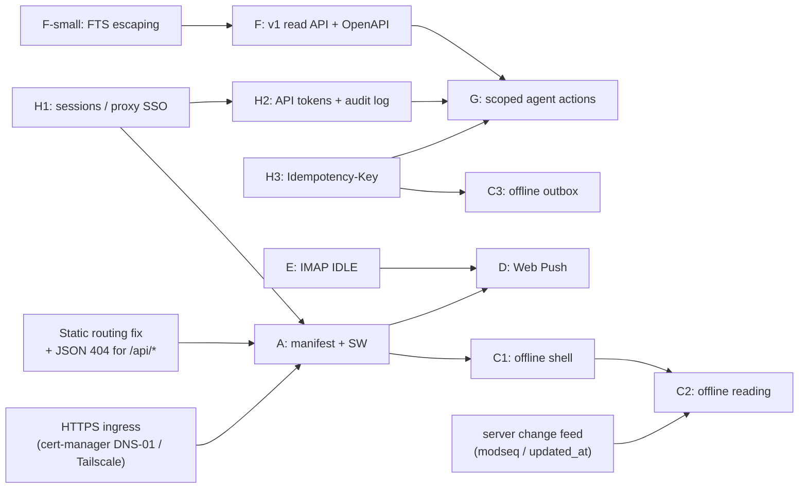

# Feasibility: Android PWA and AI-agent API for a Stork fork

Target: a personal fork with Gmail and Namecheap Private Email as the authoritative IMAP providers, a web UI and then an installable Android PWA, AI agents working through an API, and a private container/Kubernetes deployment.

Evidence:
- Code at upstream `1b1c0f2`.
- A demo-mode server driven by Chromium 1194 at a 390×844 mobile viewport. Screenshots are in `screenshots/`, and the scripts are in `scripts/shots.mjs` and `scripts/playwright.audit.config.ts`.
- Probe scripts in `../arch/evidence/`.

**Effort scale:** S ≤ 2 dev-days · M = 3–5 · L = 6–10+.
**Classes:** SMALL ENHANCEMENT (contained, no new cross-cutting concept) · ARCHITECTURAL CHANGE (new cross-cutting model, storage or process change).

---

## 0. Summary

| # | Capability | Today | Class | Effort | Hard blockers |
|---|---|---|---|---|---|
| A | Installable Android PWA | No manifest, no SW, no PNG icons. **The server serves `index.html` for `/sw.js` and `/manifest.webmanifest`.** | SMALL | **S** (1–2 d) | HTTPS ingress; auth (H1) before exposing it beyond localhost |
| B | Responsive inbox, thread and compose | Already works below `md` (drawer plus list/detail toggle). Rough edges: `100vh`, hover-only actions, cramped thread toolbar, desktop-only hints. | SMALL | **S** (2 d) | none |
| C1 | Offline app shell | none | SMALL | S (0.5 d after A) | A |
| C2 | Offline **reading** (cached mail) | none. Every view fetches live. | **ARCHITECTURAL** | **L** (6–10 d) | A, H1. It also needs a server change feed, because messages have no `updated_at`/modseq. It also needs a decision on plaintext-on-device versus the encryption-at-rest premise. |
| C3 | Offline **drafting** and an outbox | Drafts autosave to `localStorage` (plaintext, per device). The server `/api/drafts` exists but **the UI never uses it**. No IMAP Drafts sync. | SMALL→MEDIUM | M (3–4 d) | H3 (idempotent send), A |
| D | Background notifications (Web Push) | The UI polls every 3 s and calls `new Notification()`, which **throws on Android Chrome**. Nothing reaches a backgrounded or closed PWA. | SMALL→MEDIUM (new subsystem, contained) | **M** (3–4 d) | A, H1, HTTPS. Egress to FCM. Latency is bounded by sync (E). |
| E | IMAP IDLE | none. A fixed, non-configurable 5-minute poll. | MEDIUM (inside existing seams) | **M** (3–5 d) | none. Interacts with the two-way-sync work in `audit/sync`. |
| F | Agent-oriented search and retrieval | Read endpoints exist. **Search returns 500 for e-mail addresses, hyphens and apostrophes.** Offset-only pagination, DB-row-shaped JSON, no OpenAPI, no raw message. | SMALL (fixes) + MEDIUM (v1 read API) + **ARCHITECTURAL** (raw source storage) | S + M + M | H1/H2 for anything beyond localhost |
| G | Safe agent actions with scoped permissions | **There is no user or token model at all.** Every caller can do everything, including server-side deletes and sending. | **ARCHITECTURAL** | **M–L** (5–8 d) | H1, H2 |
| H1 | Human auth (sessions) | none. SECURITY.md defers to a reverse proxy. CORS `*`. | **ARCHITECTURAL** | M (3–5 d), or S with proxy SSO | none; this is the root blocker |
| H2 | API tokens, audit log | none. `console.*` logs only. | ARCHITECTURAL (tokens) / SMALL (audit table) | M + S | H1 |
| H3 | Idempotent mutations (`Idempotency-Key`) | none. A retried `POST /api/send` sends twice. | SMALL (middleware plus table) | S (2 d) | none |



**Suggested order:**
1. H1, the static-routing fix and FTS escaping (week 1).
2. A, B, C1 and H3 (week 2).
3. E and D (week 3).
4. H2, F and G (weeks 4–5).
5. C2 last, and only if offline reading turns out to matter.

---

## Server static-routing gotcha and CSP (affects A, C, D, F)

`src/api/server.ts:51-52, 118`:

```ts
app.use("/assets/*", serveStatic({ root: "./frontend/dist" }));
app.get("/stork.svg", serveStatic({ root: "./frontend/dist", path: "stork.svg" }));
...
app.get("*", serveStatic({ root: "./frontend/dist", path: "index.html" }));   // SPA fallback
```

Only `/assets/*` and `/stork.svg` are real files. **Everything else that Vite copies from `frontend/public/` into `dist/` is shadowed by the SPA fallback**, including `manifest.webmanifest`, `sw.js`, icons, `favicon.ico` and `robots.txt`. Those paths get `200 text/html`. Verified against the running demo server:

```
/manifest.webmanifest -> 200 text/html
/sw.js                -> 200 text/html
/favicon.ico          -> 200 text/html
/api/nonexistent      -> 200 text/html     <- also bad for agents
navigator.serviceWorker.register('/sw.js') ->
  SecurityError: ... The script has an unsupported MIME type ('text/html').
```

Fix (S, about half a day). Touch `src/api/server.ts` and add a test in `src/api/server.test.ts`. The tests currently run without `dist`, so build a fixture `dist` in a temp dir.
1. After the routes, `app.all("/api/*", c => c.json({ error: "Not found" }, 404))`, plus `app.onError` returning a JSON error envelope. Today Hono's default plain-text 404/500 leaks through, and the 25 unguarded `await c.req.json()` calls turn malformed JSON into a plain-text 500.
2. `app.use("/*", serveStatic({ root: "./frontend/dist" }))`. Hono's `serveStatic` calls `next()` when the file does not exist, so the SPA fallback still works. Restrict the fallback to `GET` requests for paths without a file extension.
3. Cache headers:
   - `Cache-Control: no-cache` on `index.html`, `sw.js` and `manifest.webmanifest`. Without this, users get stuck on an old SW.
   - `public, max-age=31536000, immutable` on the hashed `/assets/*`.
4. Make the static root absolute (`fileURLToPath(new URL("../../frontend/dist", import.meta.url))`) or configurable. It is cwd-relative today.

**CSP** (`server.ts:28-49`) is applied **only to `text/html` responses**: `default-src 'self'; script-src 'self'; … connect-src 'self'; frame-src 'self' blob:`.
- It has no `worker-src` and no `manifest-src`. Under CSP3 fallback rules, `worker-src` falls back to `child-src`, then `script-src 'self'`, and `manifest-src` falls back to `default-src 'self'`. A **same-origin** `/sw.js` and manifest are therefore *already permitted*. Add `worker-src 'self'; manifest-src 'self'` explicitly so the next refactor does not break them.
- `script-src 'self'` forbids inline scripts. With `vite-plugin-pwa`, use `injectRegister: 'script'` (an external `registerSW.js`) or register manually from `main.tsx`. **Do not** use the inline-snippet mode.
- Push subscriptions do not need `connect-src` changes. The browser talks to the push service itself.
- If H1 is done with a reverse proxy, the manifest request goes out **without credentials** by default. Use `<link rel="manifest" href="/manifest.webmanifest" crossorigin="use-credentials">`, or let the proxy bypass auth for `/manifest.webmanifest`, `/sw.js`, `/assets/*` and the icons.

---

## A. Installable Android PWA

**Current state**
- `frontend/index.html` has no `<link rel="manifest">`, no `theme-color` and no `apple-touch-icon`. The only icon is `public/stork.svg`. Chrome's install prompt needs 192 px and 512 px PNG icons, or a maskable icon. Verified in Chromium: `manifestLink:false, themeColor:false, swRegs:0`.
- There is no service worker anywhere in `frontend/src`.
- Installability requires a **secure context**: HTTPS, or `localhost`. The project's default `127.0.0.1:3100` binding is fine on a desktop but unreachable from a phone.

**Changes**
- `frontend/public/manifest.webmanifest`: `name`, `short_name`, `start_url: "/"`, `scope: "/"`, `display: "standalone"`, `background_color`, `theme_color` (#7c3aed matches `stork-600`), and `icons` (192, 512, maskable 512).
- `frontend/public/icons/*.png`. Generate them from `docs/logo.svg`; `docs/favicon-candidates/` already holds PNG renders.
- `frontend/index.html`: the manifest link, `meta theme-color`, and `viewport-fit=cover`.
- The service worker. Either use `vite-plugin-pwa` (Workbox; MIT; adds a devDependency) in `frontend/vite.config.ts`, or hand-write `frontend/public/sw.js` (precache the app shell with `NetworkOnly` for `/api/*`). Register it from `frontend/src/main.tsx`.
- `src/api/server.ts`: the routing and caching fix above.
- Deployment: an HTTPS ingress, for example cert-manager with Let's Encrypt **DNS-01**, which works for a private IP behind a public DNS name, or Tailscale HTTPS certificates. Avoid self-signed or private-CA certificates. Android Chrome handles user-installed CAs inconsistently for PWAs and push.

**Classification:** SMALL ENHANCEMENT. **Effort:** S (1–2 d).
**Blockers:** HTTPS, plus **auth (H1) before reachability from a phone**. Today the whole API is unauthenticated with CORS `*`; see `audit/security`.

## B. Responsive inbox, thread and compose

**Current state** (Tailwind breakpoints across `frontend/src`: `sm:` ×13, `md:` ×9, `xl:` ×1)
- `App.tsx:847-1010`: below `md` the sidebar is an off-canvas drawer (`fixed … -translate-x-full md:translate-x-0`) with a backdrop. The list pane is `w-full md:w-80 xl:w-96`, and the list and detail panes toggle with `hidden md:flex`. `MessageDetail.tsx:219` shows a Back button with `md:hidden`.
- `ComposeModal.tsx:343-349` renders a bottom sheet (`items-end`, `rounded-t-xl`, `max-h-[80vh]`) below `sm`, and an "expand" button switches to full screen.
- Settings uses a horizontal tab bar below `sm` (`Settings.tsx:52,77`).
- Screenshots at 390×844 (`screenshots/01…04`) show **no horizontal page overflow** (`scrollWidth == clientWidth == 390`) on the inbox and the thread.

**Rough edges seen in the screenshots and code**
1. `h-screen` (100vh) is used for the root layout (`App.tsx:781,809,836`, `SetupScreen.tsx:47`, `Welcome.tsx:119`). On Android Chrome the dynamic toolbar hides the bottom of the layout, including Compose's Send bar. Use `h-dvh` (Tailwind 3.4 supports it) and `env(safe-area-inset-*)` padding for standalone mode.
2. Hover-only affordances do not exist on touch: the quick actions and star (`MessageList.tsx:197,215`, `opacity-0 group-hover:opacity-100`) and the 30%-opacity checkboxes (`:235`). Show them always below `md`, or add long-press/swipe.
3. The thread header toolbar (`03-thread-390x844.png`) is cramped. Labels like "Collapse all", "2 messages" and "Mark unread" wrap onto two lines, and the right-most label icon is clipped at the viewport edge. Collapse it into an overflow (⋮) menu below `sm`.
4. Compose (`04-compose-390x844.png`): the From `<select>` touches the right edge, "⌘+Enter to send" shows on touch devices, and **there is no visible Compose entry point on the mobile list.** Compose lives in the drawer or behind the `c` shortcut. Add a FAB.
5. The hamburger is `absolute top-0 left-0 z-20` (`App.tsx:895`). In demo mode it overlaps the banner text (`01-inbox`). Check it against the list header in normal mode.
6. Polling `/api/sync/status` every 3 s (`hooks.ts:76-86`) drains the battery on a phone. Pause it on `visibilitychange` and back off when idle.

**Files:** `frontend/src/App.tsx`, `components/MessageList.tsx`, `components/MessageDetail.tsx`/`MessageHeaderActions.tsx`/`ThreadMessage.tsx`, `components/ComposeModal.tsx`, `hooks.ts`, `index.css`. **Classification:** SMALL. **Effort:** S (about 2 d, plus updating the many component tests).

## C. Offline reading and drafting

**Current state**
- **Server side:** data is encrypted at rest and the container **boots locked**. Until someone unlocks it in the UI, every data route returns `423` (`server.ts:66-71`), and `api.ts:31-37` turns a 423 into the Unlock screen.
- **Client side:** nothing is cached except `localStorage` preferences and **compose drafts** (`compose-utils.ts:30`, autosaved on every change in `ComposeModal.tsx:192-194`). Those drafts are plaintext on the device and do not sync across devices.
- The server drafts API (`src/api/routes/drafts.ts`: list, get, create, update, delete on the `drafts` table) is **never called by the UI**, and nothing APPENDs to the IMAP Drafts folder.
- Messages carry `created_at` but **no `updated_at` or change sequence**, so a client cannot ask "what changed since X". Flag and label edits are invisible to a cache.

**C1, offline shell (SMALL, S):** the SW precaches `index.html` and `/assets/*`, serves `NetworkOnly` for `/api/*`, and shows an offline banner. **Never cache 423 or 401 responses.**

**C2, offline reading (ARCHITECTURAL, L):**
- A **server change feed**: add `messages.updated_seq` (a global monotonically increasing counter bumped by triggers on flag, label and delete changes, plus a tombstones table), and `GET /api/v1/changes?since=<seq>`. Touch `schema.ts`, triggers, `messages.ts`, `labels.ts` and `imap-sync.ts` (flag sync), and add a new route.
- A client cache in IndexedDB (for example Dexie, or hand-rolled): list pages, plus bodies for messages that were opened or are recent. Add a cache-eviction policy and a storage quota check.
- **A security decision.** Caching mail on the phone puts plaintext outside the server vault. Options:
  - (a) Accept it and rely on Android file-based encryption plus the device lock.
  - (b) Encrypt cache records with a **non-extractable WebCrypto AES-GCM key** stored in IndexedDB. That protects exported or backed-up files, but not an unlocked device.
  - (c) Derive the key from a PIN at app open, at a UX cost.
  - Record the choice in SECURITY.md. The same reasoning already applies to today's `localStorage` drafts.
- Lock interaction: if the server restarts it is locked. The PWA should keep showing cached mail with a "server locked, unlock" banner, not wipe it.

**C3, offline drafting and outbox (SMALL→MEDIUM, M):**
- Move drafts to the server API: debounce `PUT /api/drafts/:id`, keep `localStorage`/IndexedDB as the offline write-ahead copy, and reconcile with `updated_at` (last-writer-wins). Optionally APPEND to the IMAP `Drafts` folder later; that falls under the two-way-sync work in `audit/sync`.
- Outbox: queue sends in IndexedDB and flush them with the Background Sync API (supported on Chrome Android), **each carrying an `Idempotency-Key` (H3)**. Without H3, an offline retry can send the same e-mail twice.
- Files: `ComposeModal.tsx`, `compose-utils.ts`, the SW, `drafts.ts` (add `If-Match`/`updated_at` concurrency) and `send.ts`.

## D. Background notifications (Web Push)

**Current state**
- The server polls IMAP every **5 minutes**, hard-coded with no knob (`sync-scheduler.ts:63`; `lifecycle.ts` passes no interval).
- The browser polls `/api/sync/status` every 3 s while open. When the inbox unread count rises and the document is unfocused, `useDesktopNotifications.notifyNewMail` (`hooks.ts:873-886`, called from `App.tsx:335`) calls **`new Notification()`**. **On Android Chrome that constructor throws** "Illegal constructor; use ServiceWorkerRegistration.showNotification()". The icon `/favicon.svg` does not exist and resolves to index.html. A backgrounded PWA's timers are frozen, so nothing would fire even if the constructor worked.

**Required changes**
1. SW: `push` event, then `registration.showNotification(...)`; `notificationclick`, then focus or open `/#message/<id>`. That needs deep links, and **the app currently has no URL routing**: `useHistoryNavigation` (`hooks.ts:713-770`) uses `pushState` without paths. Add path-based routes, for example `/m/:id` and `/l/:labelId`. That also improves B.
2. Server, new module `src/push/`:
   - A VAPID key pair generated at setup and stored in the encrypted DB (new table `push_subscriptions(id, endpoint, p256dh, auth, user_agent, created_at, last_ok_at)`, plus `push_vapid`). A migration goes in `schema.ts`.
   - Routes: `GET /api/push/vapid-public-key`, and `POST`/`DELETE /api/push/subscriptions`.
   - A sender, using either `web-push` (MPL-2.0, compatible) or a hand-rolled RFC 8291 aes128gcm with an RFC 8292 VAPID JWT on `node:crypto` (about 200 LOC).
   - Handle 404/410 by pruning the subscription.
3. Trigger: hook `onSyncComplete` (`lifecycle.ts:143`) or a scheduler event emitter, and only when **INBOX** gained unseen messages. `SyncAllResult.folders` carries per-folder results. Keep payloads minimal ("2 new messages", optionally the sender name) and make it configurable. RFC 8291 payloads are end-to-end encrypted to the browser, but FCM still sees timing and metadata.
4. Settings UI to enable push and list or revoke devices (`components/settings/GeneralTab.tsx`).

**External dependency:** Chrome on Android delivers push through **Google FCM** (`fcm.googleapis.com`). The server needs egress to whatever endpoint the subscription names, and the phone needs Google Play Services. No Google account or API key is required with VAPID. This is the one unavoidable third party in an otherwise self-contained path. Firefox Android uses Mozilla autopush.

**Limitations:** a locked server, for example after a pod restart, cannot sync, so it sends no pushes. Optionally store the VAPID key **outside** the vault so the server can send a "Stork restarted and is locked" push; that is a design decision. Without E, latency is up to 5 minutes.

**Classification:** SMALL→MEDIUM (a new contained subsystem). **Effort:** M (3–4 d). **Blockers:** A, H1 (subscription endpoints must be authenticated), HTTPS, and E for timeliness.

## E. IMAP IDLE

**Current state**
- No IDLE. `ConnectionPool.acquire()` builds a fresh `ImapSync` for every cycle (`connection-pool.ts:55-60`). `ImapSync.syncAll()` walks **all** folders, and nothing listens between cycles.
- The mock IMAP server answers `IDLE` with `+ idling` and never pushes `EXISTS` (`mock-imap-server.ts:239-246`), so IDLE behaviour is untestable today.
- imapflow (1.x and 2.x) supports IDLE natively. It auto-IDLEs on a selected mailbox when the connection is otherwise idle (`maxIdleTime` and `disableAutoIdle` options) and emits `exists`, `expunge` and `flags` events. 2.0 fixes "re-arm auto-IDLE after an IDLE session ends on its own".

**Changes**
1. `src/sync/idle-watcher.ts` (new): one long-lived `ImapFlow` per IMAP connector with `SELECT INBOX` and auto-IDLE. On `exists`, debounce for about 2 s and call `scheduler.requestSync(connectorId, { folders: ["INBOX"] })`. Reconnect with jittered backoff. Set `maxIdleTime` ≤ 25 min (RFC 2177 recommends re-issuing within 29 min; NATs drop silent TCP sooner, so also enable TCP keepalive).
2. `src/sync/sync-scheduler.ts`:
   - Start and stop watchers alongside connectors (`addConnector`, `removeConnector`, `stop`).
   - Replace the "throw if already syncing" behaviour (`runSync`) with **coalescing**: a `dirty` flag that re-runs once the current sync finishes. The periodic poll stays as a safety net, and its interval should become configurable.
3. `src/sync/imap-sync.ts`: add a folder-scoped entry point, `syncFolders(paths)`, instead of only `syncAll()`. Optionally use CONDSTORE/`CHANGEDSINCE` for cheap flag deltas, which Gmail and Dovecot both support.
4. `src/sync/connection-pool.ts`: count the IDLE connection against `maxTotal`. Gmail allows **15 simultaneous IMAP connections per account**, so 1 sync plus 1 IDLE is fine. Check Namecheap's limit empirically.
5. Shutdown in `lifecycle.ts`, and updated status in `GET /connectors/inbound/:id/sync-status` (idle connected, last event).
6. Tests: implement real `IDLE` and `EXISTS` push in `mock-imap-server.ts`, and add integration tests against the Dovecot harness (`audit/harness/dovecot.sh`).
7. Gmail detail: watching only `INBOX` misses mail that filters skip-the-inbox. Optionally watch `[Gmail]/All Mail` on a second connection.

**Classification:** MEDIUM enhancement within the existing scheduler seam, not architectural. **Effort:** M (3–5 d).

## F. Agent-oriented search and retrieval

**Current surface** (80 routes; the full list is in `../arch/evidence/routes-implemented.txt`)

| Need | Endpoint(s) | Shape and problems |
|---|---|---|
| List or browse | `GET /api/inbox/{unified,all-messages,unread-messages}`, `GET /api/labels/:id/messages`, `GET /api/labels/filter?ids=`, `GET /api/connectors/inbound/:id/folders/:fid/messages` | Rows: `{id, uid, message_id, in_reply_to, subject, from_address, from_name, to_addresses, date, flags, size, has_attachments, preview, inbound_connector_id}`. **`to_addresses` is a JSON-encoded string inside JSON**, and `flags` is a raw string. Pagination is `limit` (≤ 200, `validation.ts:17-48`) plus `offset` only. Totals come from separate `/count` endpoints. Offset paging shifts as mail arrives, so an agent paging through can skip or duplicate rows. |
| Search | `GET /api/search?q=&inbound_connector_id=&limit=&offset=` | Returns `[{id, subject, from_address, from_name, date, snippet, folder_path, rank}]` with **no total**, and the snippet contains `<mark>` HTML. **Free text goes straight into FTS5 `MATCH`** (`search.ts`). Verified: `john@example.com`, `Re: invoice`, `e-mail`, `follow-up`, `it's`, `C++`, `50%`, `-x` and `"unbalanced` all return **HTTP 500 (plain text)**. Invalid `before:` dates are silently ignored. `docs/api.md` documents an `identity_id` parameter that does not exist. |
| Read one | `GET /api/messages/:id` | Returns the **raw DB row** (`m.*` plus `folder_path`/`folder_name`): `text_body`, `html_body`, `html_text_body`, decompressed `raw_headers`, and internal columns (`pending_archive`, `deleted_from_server`, `uid`). `references` is a JSON array for IMAP mail but space-separated for sent mail (`messages.ts:87-96`). |
| Thread | `GET /api/messages/:id/thread` | Matches Message-ID, In-Reply-To and References **within the same `inbound_connector_id`**. Locally stored sent copies have `inbound_connector_id = NULL` (`send.ts:146-170`), so **they never appear in threads**. With Gmail, the IMAP-synced `[Gmail]/Sent Mail` copy does appear. With Namecheap, nothing is APPENDed to Sent, so your own replies are missing. There is no stable thread id. |
| Attachments | `GET /api/messages/:id/attachments`, `GET /api/attachments/:aid`, `GET /api/attachments/by-cid/:mid/:cid` | Fine. They return the binary with a correct `Content-Disposition`. |
| **Raw message (.eml)** | **absent** | **The original RFC 5322 source is never stored.** Only parsed parts, compressed headers and attachments are kept. Faithful `.eml` export, DKIM/S/MIME verification and re-import are impossible for already-synced mail. In connector mode the server copy has been deleted, so mail cannot be re-fetched either. |
| Errors | – | Unknown `/api/*` paths return **200 index.html** in production. 500s are plain text. Malformed JSON bodies return 500. There is no error-code taxonomy. |
| Long operations | `POST /connectors/inbound/:id/sync` | It **awaits the entire sync** inside the HTTP request, and the frontend's fetch timeout is 30 s. Agents need `202` plus a job id. |
| Discoverability | `docs/api.md` | Out of date: 3 phantom routes and 19 undocumented ones. No OpenAPI. |

**Changes**
- **F-small (SMALL, S):**
  - Tokenize free text and emit `"tok"` FTS5 string literals, keeping an `fts:` escape hatch for power syntax, in `src/search/search.ts`.
  - Validate operator values (`before:`/`after:` dates) and return 400 JSON on invalid input.
  - Add a JSON 404/500 envelope (server routing fix above).
  - Add tests in `src/search/*.test.ts` and `src/api/routes/search.test.ts`.
- **F-v1 (MEDIUM, M, 4–6 d):** a versioned, normalized read API under `src/api/routes/v1/`:
  - `GET /api/v1/messages?q=&label=&from=&to=&after=&before=&unread=&has_attachment=&cursor=&limit=` returns `{items, next_cursor, total_estimate}`, with keyset pagination on `(date DESC, id DESC)`.
  - Items: `{id, thread_id, message_id, date, from:{name,address}, to:[…], cc:[…], subject, labels:[…], flags:[…], snippet_text, has_attachments, size}`.
  - `GET /api/v1/messages/:id?body=text|html|both&max_chars=`, `GET /api/v1/threads/:thread_id`.
  - Define the shapes with **`@hono/zod-openapi`** (adds `zod`) so OpenAPI is generated and requests are validated. Publish `/api/v1/openapi.json`.
  - Optionally add a thin **MCP server** as a separate process or package that wraps v1 for LLM agents (`search_mail`, `get_message`, `get_thread`, `create_draft`), keeping the core free of agent-specific code.
  - Fix threading by setting `inbound_connector_id` for sent mail, or by threading across connectors per identity.
- **F-raw (ARCHITECTURAL, M):**
  - Store the raw source going forward: compressed in the blobs DB, keyed by SHA-256, with a `messages.raw_hash` column. That roughly doubles the per-message size for mail with attachments, unless attachments are split out and referenced.
  - For existing mail, either re-fetch by UID in mirror mode or offer a clearly-labelled *reconstructed* MIME.
  - Endpoint: `GET /api/v1/messages/:id/raw` returning `message/rfc822`.
  - Touch `imap-sync.ts` `fetchUidBatch`, `email-storage.ts` and `schema.ts`.

## G. Safe agent actions with scoped permissions

**Current state:** **there is no principal, user, session or token concept at all** (`server.ts`). Every caller that can reach the port while the container is unlocked can:
- send e-mail as any identity (`POST /api/send`)
- delete messages permanently, both locally (`DELETE FROM messages`) and **on the IMAP server in connector mode** (`DELETE /api/messages/:id`, `POST /api/messages/bulk {action:"delete"}`)
- wipe the server mailbox (`POST /api/connectors/inbound/:id/clean-server`)
- edit connectors, and read the Cloudflare webhook secret through `GET /api/connectors/inbound`
- change the password and rotate the recovery key, given the password

**Design (ARCHITECTURAL, M–L, 5–8 d)**
1. **Principals:** `session` (the human, from H1) and `api_token` rows: `api_tokens(id, name, token_hash, scopes JSON, created_at, last_used_at, expires_at, revoked_at)`. Only a SHA-256 of a 32-byte random token is stored, it is shown once, and the format is `stork_pat_<base32>`.
2. **Scopes**, enforced by a route-to-scope table in one middleware placed after the lock middleware in `server.ts`:
   - `mail.read`, `mail.search`, `attachments.read`
   - `labels.write`, `flags.write`
   - `drafts.write`
   - `mail.send` (off by default)
   - `mail.delete` (off by default; local soft-delete only)
   - `connectors.admin`, `security.admin` (sessions only, never tokens)
3. **Safe-by-construction agent verbs:**
   - **Drafts as the agent outbox.** Agents `POST /api/drafts` (the server API already exists and is unused) and a human approves and sends in the UI. A `propose_send` flow with approve/deny endpoints could notify through Web Push (D).
   - **Soft delete:** add `messages.trashed_at`. Hard delete and server delete stay human-only.
   - **`dry_run=true`** on bulk operations returns the affected ids.
   - **Send guardrails per token:** a recipient allowlist, a rate limit, and a max-recipients cap.
   - Agent-scoped responses must never include credentials or secrets.
4. **UI:** a Settings → "API tokens" tab to create, scope, revoke and inspect `last_used`.
5. **Audit (H2)** for every token action.

**Blockers:** H1 (a human principal is needed to mint tokens) and H3 (agents retry).

## H. API auth, audit logs and idempotent mutations

### H1: Human authentication

**Current:**
- No authentication. `SECURITY.md` says to put Stork "behind an authenticated reverse proxy".
- `cors()` is called with defaults (`Access-Control-Allow-Origin: *`), and the installed hono 4.12.14 is affected by GHSA-88fw-hqm2-52qc (CORS reflection). Any web page the user visits can read the API if the browser can reach it, as with a LAN or Tailscale address. Details are in `audit/security`.
- The unlock password is checked once per boot, not per client.

**Option 1 (S): proxy SSO at the Kubernetes ingress**, using oauth2-proxy, Authelia or Authentik forward-auth.
- Stork itself stays unchanged.
- The PWA works through the proxy's cookie. Remember the `crossorigin="use-credentials"` manifest caveat, and that SW updates need the session to be valid.
- Agents need either a proxy-level token or an ingress bypass for `/api/v1/*` with Stork-validated Bearer tokens, which means H2 anyway.
- Remove the wildcard CORS in either case.

**Option 2 (M): in-app sessions.**
- `POST /api/login {password}` verifies against the existing Argon2id envelope. That takes about 4 s per login and blocks the event loop, so move the KDF to a worker first (`audit/perf`, `../arch/MAINTAINABILITY.md` §2).
- It issues an `HttpOnly; Secure; SameSite=Strict` session cookie. Sessions can be in-memory, since a restart locks the vault anyway, or in a `sessions` table.
- CSRF: SameSite=Strict, plus a required `Content-Type: application/json` / custom header check on mutations.
- Bind `/api/setup` to a one-time setup token printed to the logs, to remove the first-visitor-owns-it race.
- Later, add WebAuthn/passkeys, which work well on Android.
- Files: `server.ts`, a new `src/api/auth.ts`, `encryption.ts`, frontend `App.tsx`/`api.ts` and a login screen.

**Recommendation:** use Option 1 immediately for safety and Option 2 as the fork's own model. A PWA plus agent tokens fits an in-app principal model better.

### H2: Audit log

**Current:** none. Logs are `console.*`, unstructured, with no request id.

**Change (SMALL, S):**
- An `audit_log(id, ts, principal_type, principal_id, method, path, action, target_ids JSON, status, idempotency_key, ip, user_agent)` table in the encrypted DB, written by middleware for every mutating request and every token-authenticated request.
- `GET /api/audit?cursor=` (session-only) and a Settings view.
- A retention setting.
- Add request ids plus structured JSON logs for Kubernetes.
- Files: `server.ts`, a new `src/api/audit.ts`, `schema.ts`.

### H3: Idempotent mutations

**Current:** none.
- `POST /api/send` performs SMTP and then inserts. A client or SW retry **sends twice**.
- `POST /api/drafts` duplicates.
- Connector-mode deletes are not idempotent server-side.

**Change (SMALL, S, 2 d):** middleware for the `Idempotency-Key` header (IETF draft-ietf-httpapi-idempotency-key-header) on `POST`/`PATCH`/`DELETE`:
- A table `idempotency_keys(principal, key, method, path, request_sha256, state: in_flight|done, status, response_json, created_at)` with a 24 h TTL. Because Stork is single-process, an in-memory in-flight lock plus the DB row is enough.
- A replay with the same request hash returns the stored response. A different hash returns `422`. An in-flight duplicate returns `409`.
- For `/send`, persist the key *before* calling SMTP, and derive a deterministic `Message-ID` from it so that a crash between SMTP and the DB write can be detected downstream.
- Files: `server.ts`, a new `src/api/idempotency.ts`, `send.ts`, `drafts.ts`, `schema.ts`; the frontend sends a UUID per compose.

---

## Appendix: verification log

- Demo server: `STORK_DEMO_MODE=1` from a scratch copy with `frontend/dist` built by `vite build`. Probed with `curl` and with Chromium 1194 at 390×844, DPR 2, `isMobile`, touch.
- Screenshots:
  - `screenshots/01-inbox-390x844.png`: All Inboxes list; the hamburger overlaps the demo banner.
  - `screenshots/02-sidebar-drawer-390x844.png`: drawer with Compose, Search and labels.
  - `screenshots/03-thread-390x844.png`: thread view; toolbar wrapping, label icon clipped at the right edge.
  - `screenshots/04-compose-390x844.png`: bottom-sheet compose; desktop shortcut hint.
- Console errors during the run: three `500`s from `/api/sync/status`. In demo mode there is no scheduler, so `getScheduler()` throws every 3 s per open tab and fills the server log with stack traces. The SW MIME-type error came from the deliberate registration probe.
- The search, migration and cipher probes are in `../arch/evidence/`.
